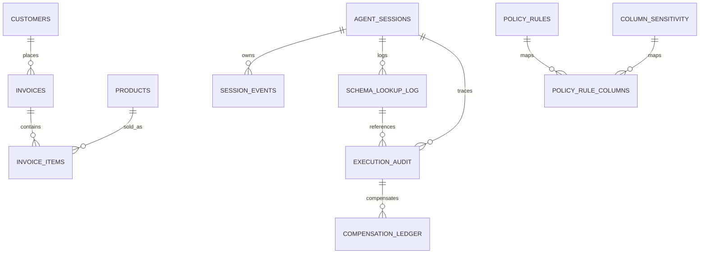

# ERD Notes

This document mirrors the SQL in `database/schema.sql` and `database/agent_schema.sql`.

## Operational database

### customers
- `customer_id` PK
- `country` NOT NULL

### products
- `stock_code` PK
- `description` nullable

### invoices
- `invoice_no` PK
- `invoice_date` NOT NULL
- `customer_id` nullable FK -> `customers.customer_id` with `ON DELETE SET NULL`
- `status` NOT NULL with allowed values `completed`, `cancelled`, `adjustment`

### invoice_items
- `invoice_item_id` PK
- `invoice_no` FK -> `invoices.invoice_no` with `ON DELETE CASCADE`
- `stock_code` FK -> `products.stock_code` with `ON DELETE RESTRICT`
- `quantity` NOT NULL and `<> 0`
- `unit_price` NOT NULL

### Operational relationships
- `customers` 1-to-many `invoices`
- `invoices` 1-to-many `invoice_items`
- `products` 1-to-many `invoice_items`

## Agent-system database

### agent_sessions
- `session_id` PK
- `session_status` allowed values `active`, `ended`, `expired`

### session_events
- weak entity keyed by `(session_id, event_seq)`
- FK `session_id` -> `agent_sessions.session_id` with `ON DELETE CASCADE`

### policy_rules
- `rule_id` PK
- `rule_name` unique
- `action_type` allowed values `read`, `write`, `ddl`
- `severity` allowed values `low`, `medium`, `high`, `critical`

### column_sensitivity
- `sensitivity_id` PK
- unique `(table_name, column_name)`

### policy_rule_columns
- bridge table for many-to-many between `policy_rules` and `column_sensitivity`

### schema_lookup_log
- `lookup_id` PK
- optional FK to `agent_sessions`

### execution_audit
- `audit_id` PK
- optional FK to `agent_sessions`
- optional FK to `schema_lookup_log`
- `guardrail_verdict` allowed values `allow`, `confirm`, `block`
- `execution_status` allowed values `not_executed`, `committed`, `rolled_back`, `failed`
- `risk_score` numeric

### compensation_ledger
- `compensation_id` PK
- FK `audit_id` -> `execution_audit.audit_id`
- `compensation_status` allowed values `pending`, `applied`, `not_required`, `failed`

## Mermaid

